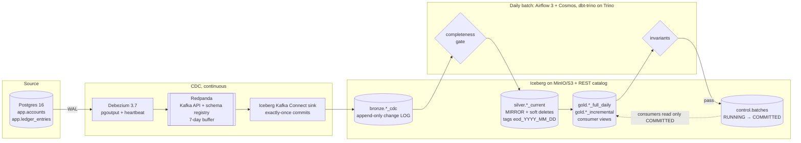

# Ledger Lakehouse

**A CDC-to-Iceberg finance data platform that publishes reconciled daily FULL
and INCREMENTAL datasets.**

A double-entry ledger in Postgres is captured by CDC into an Iceberg lakehouse.
Every business day the platform publishes, for accounts and account balances:

* **FULL**: the end-of-day state, one row per key (the official dataset)
* **INCREMENTAL**: the net changes of that day, one row per changed key, `op` = I/U/D

Both come from the **same run and the same cut-off**, so they always agree. A new
consumer loads the latest FULL once, then applies each day's INCREMENTAL. Every
run proves it before publishing:

* `FULL(N-1) + INCREMENTAL(N) = FULL(N)`, on row counts **and** an order-independent checksum
* every ledger transaction balances (double entry)
* published balances equal an **independent** recompute from the raw change log

The point of the project is less the tools than the production behaviour of a
finance pipeline: CDC delete semantics, idempotent reruns, a provable
completeness gate, consistency between outputs, auditability, and failure
containment. Every claim below was run, and the evidence is in the demo output
and the ADRs.

## Architecture



| Layer | What it is | Built by |
|---|---|---|
| **bronze** `lakehouse.bronze.<table>_cdc` | every change event, append-only, partitioned by **source commit day**; unique key `(pk, _lsn)`; the system of record and replay source | Iceberg sink (no transformation) |
| **staging** `stg_*_latest` | latest event per key inside the batch window `[window_start, window_end)`, ordered by `_lsn` | dbt macro `cdc_latest_event` |
| **silver** `*_current` | mirror of the source with soft deletes; MERGE of changed rows only (hash diff); balances recomputed for affected accounts | dbt macro `cdc_current` |
| **gold** | `*_full_daily` (partition `snapshot_date`), `*_incremental` (partition `batch_date`), both read from the silver **EOD tag**; views `gold.accounts`, `gold.account_balances` | dbt macros `gold_publish` |
| **control** `control.batches` | window, LSN/commit-time watermarks, counts, checksums, status | `ledger_pipeline` |

**Stack (all pinned):** Postgres 16.15 · Debezium 3.7.0 (Kafka Connect 4.3, Avro) ·
Redpanda v26.2.6 · Apache Iceberg Kafka Connect sink 1.12.0 (built from ASF source) ·
MinIO (Chainguard) · Iceberg REST catalog 1.10.1 · Trino 484 · dbt-core 1.11.16 +
dbt-trino 1.11.0 · Airflow 3.3.2 + Astronomer Cosmos 1.15.1 · pyiceberg 0.12.0 · uv.
Everything runs in docker-compose and fits a 16 GB laptop (≈11.7 GB of memory
limits, ≈5 GB actually used).

## Quickstart

```bash
make demo        # RESETS the local stack, then: up, seed, 3 business days, evidence (~10-15 min)
```

Or step by step:

```bash
make up                                   # build (cached), start, wait healthy, bootstrap connectors
make seed                                 # initial load = business day 2026-01-01
make airflow-run DATE=2026-01-01 CUTOFF=now   # publish it through Airflow
make traffic DATE=2026-01-02 PACE=30      # one business day of traffic, spread over 30 s
make airflow-run DATE=2026-01-02 CUTOFF=now
scripts/demo-report.sh 2026-01-02         # evidence for that day
make trino                                # SQL shell (lakehouse catalog)
```

| UI / endpoint | |
|---|---|
| Airflow | http://localhost:18090 (no login locally) |
| Trino | `make trino`, or any client on `localhost:18080`, user `admin`, no password |
| MinIO console | http://localhost:9001 |
| Redpanda Console | `docker compose --profile ui up -d` → http://localhost:8088 |

`make run-day DATE=… CUTOFF=now` runs the same steps without Airflow (same
functions). `make test` (pytest + dbt unit tests) and `make lint` (ruff +
sqlfluff) are what CI runs.

## Demo walkthrough

`make demo` seeds day 1 and generates three more business days with the edge
cases on purpose: new accounts, balanced transactions, status changes, reversals,
closures and deletes, back-dated entries, several updates to one key in a day, a
key created **and** deleted in the same day, and a deleted key re-inserted. Each
day is published through the Airflow DAG, then queried through Trino.

Excerpt of a real run (seed 42). A clean run takes about 14 minutes on an Apple
Silicon laptop (838 s measured, images cached). Business day 2026-01-04:

```text
--- business day 2026-01-04 ---
  generator:   close_out 2  create_then_delete 2  delete_unused 1  deposit 18  flap_freeze 1
               flap_unfreeze 1  multi_update 3  new_account 10  reinsert 1  reversal 1
               trade 10  transfer 6  withdrawal 7
run manual__2026-01-04__20261102T122404: success          <- the Airflow DAG, 30 tasks

  -- control.batches
  batch_id  |  status   |  window_start (incl.)      |  window_end (excl.)        | watermark_lsn | prev_batch_id
 2026-01-04 | COMMITTED | 2026-11-01 08:50:48.780 UTC | 2026-11-02 12:24:13.081 UTC |      27099640 | 2026-01-03

  -- INCREMENTAL: net changes of the day
     dataset      | op | n
 account_balances | I  | 10
 account_balances | U  | 35
 accounts         | D  |  1
 accounts         | I  | 11      <- 10 new + 1 re-insert; the 2 create+delete keys are absent
 accounts         | U  |  2      <- the flap (FROZEN -> ACTIVE) is absent, see below

  -- FULL: end-of-day state
 accounts_rows | accounts_active | balances_rows | consumer_view_as_of
            70 |              68 |            61 | 2026-01-04

  -- invariants (re-checked in SQL; Airflow's 'invariants' task gated the commit)
 1. FULL(prev)+INC = FULL, accounts          | 68 = 68 rows, checksum equal
 2. FULL(prev)+INC = FULL, balances          | 61 = 61 rows, checksum equal
 3. double entry: unbalanced txn/asset       | 0
 4. balances vs recompute from bronze: diffs | 0
```

The final summary, after all four days:

```text
  -- every batch: contiguous windows, each diffed against the previous COMMITTED batch
  batch_id  |  status   | watermark_lsn | prev_batch_id | accounts_active | accounts_changed | balances_changed
 2026-01-01 | COMMITTED |      26785296 | NULL          |              34 |               34 |               25
 2026-01-02 | COMMITTED |      26900816 | 2026-01-01    |              46 |               16 |               34
 2026-01-03 | COMMITTED |      26955744 | 2026-01-02    |              58 |               16 |               44
 2026-01-04 | COMMITTED |      27099640 | 2026-01-03    |              68 |               14 |               45

  -- several updates to one key in one day: gold publishes the NET change only
  batch_id  | account_id | status_before |        status_path         | updates | published
 2026-01-02 |         12 | ACTIVE        | FROZEN -> ACTIVE           |       2 | (nothing)
 2026-01-02 |         30 | ACTIVE        | FROZEN -> ACTIVE -> FROZEN |       3 | U
 2026-01-03 |          7 | ACTIVE        | FROZEN -> ACTIVE           |       2 | (nothing)
 2026-01-03 |         31 | ACTIVE        | FROZEN -> ACTIVE -> FROZEN |       3 | U
 2026-01-04 |         27 | ACTIVE        | FROZEN -> ACTIVE           |       2 | (nothing)
 2026-01-04 |         40 | ACTIVE        | FROZEN -> ACTIVE -> FROZEN |       3 | U

  pytest: 57 passed
  dbt unit tests: PASS=8 WARN=0 ERROR=0
```

Two things this run proved that weren't planned: day 4's window spans 27 hours
because the laptop slept between days (the gate waited for a fresh heartbeat and
everything still balanced), and the first demo run caught a real bug, a flap
published as `U` (see [ADR 0008](docs/adr/0008-hash-diff-change-detection.md)).

## Bronze is a log, silver is a mirror

Account 11 in the demo, over three business days (real output):

| Day | Source (Postgres) | bronze `accounts_cdc` (appended) | silver `accounts_current` (merged) | gold INCREMENTAL |
|---|---|---|---|---|
| 01-01 | created: customer 7, ACTIVE | `c` lsn 26765792, customer_id 7 | 1 row, customer 7, `is_deleted=false` | `I` |
| 01-02 | deleted | `d` lsn 26816320, **key only**: `customer_id=0`, `status=''` (NOT NULL columns arrive as type defaults) | same row, **last known values kept** (customer 7), `is_deleted=true` | `D` |
| 01-03 | re-inserted: customer 40 | `c` lsn 26904304, customer_id 40 | same row, customer 40, `is_deleted=false` | `I` |

Bronze has **3 rows** and keeps them forever: the audit trail and the replay
source (silver and gold can be rebuilt from it at any time). Silver has **1 row**,
the current truth, with deletes kept as soft deletes so they are visible
downstream (FULL 01-02 shows the account deleted with customer 7, never the
`customer_id=0` from the delete event). Gold publishes only what changed **net**
per day: a FROZEN → ACTIVE flap is mirrored in silver (`updated_at` moved) but
publishes nothing, because gold hashes only the columns it publishes.

## Design trade-offs

| Decision | Alternative | Why | ADR |
|---|---|---|---|
| Bronze is an append-only change log | bronze as a mirror | audit, replay, late events; a mirror loses history | [0004](docs/adr/0004-append-only-bronze-change-log.md) |
| Partition bronze by **source commit** day | ingestion time | late-arriving events land in their business day; window filters prune | [0005](docs/adr/0005-partition-bronze-by-source-commit-time.md) |
| Iceberg Kafka Connect sink (built from source) | Python pyiceberg consumer | exactly-once commits, schema evolution, dynamic routing | [0001](docs/adr/0001-bronze-writer.md) |
| REST catalog fixture locally, Glue on AWS | Apache Polaris | simplest reliable local catalog; catalog type is configuration | [0002](docs/adr/0002-catalog.md) |
| `REPLICA IDENTITY DEFAULT` + carry-forward on delete | `FULL` (before images) | less WAL; deletes handled row-level, never taking values from a default-filled delete event | [0006](docs/adr/0006-soft-deletes-delete-events-replica-identity.md) |
| Hash diff with `is_deleted` in the hash | column compare / every event | net-change semantics, deletes detected, idempotent reruns | [0008](docs/adr/0008-hash-diff-change-detection.md) |
| Affected-keys **recompute** of balances | delta arithmetic | self-correcting; output changes ≠ input changes | [0007](docs/adr/0007-affected-keys-recompute-for-aggregates.md) |
| Net daily changes | every change event | the FULL + INC equation is exact and checkable | [0009](docs/adr/0009-net-daily-changes-vs-every-change.md) |
| FULL as tags **and** partitions | either alone | tags freeze the input (rerun-safe); partitions serve any engine | [0011](docs/adr/0011-daily-full-as-tags-and-partitions.md) |
| Cut-off 00:00 UTC + three-part completeness gate | wait a fixed delay | provable completeness, works on idle days | [0010](docs/adr/0010-cutoff-timezone-and-completeness-gate.md) |
| Control table | Write-Audit-Publish branches | multi-table publication, engine-agnostic, audit trail | [0012](docs/adr/0012-control-table-vs-write-audit-publish.md) |
| Airflow 3 + Cosmos, batch identity from the pipeline | Dagster; dbt `invocation_id` | per-model tasks and tests; one batch identity for ~20 dbt invocations | [0014](docs/adr/0014-airflow-cosmos-and-batch-identity.md) |
| dbt-trino | Spark | set-based SQL on small daily deltas; Trino is needed anyway | [0015](docs/adr/0015-dbt-trino-vs-spark.md) |
| Closed days immutable; back-dated entries go into the next day | restatement | published history never changes silently | [0016](docs/adr/0016-back-dated-entries-policy.md) |
| Invariants gate COMMITTED; unit tests in CI | everything in every batch | data problems block batches, logic problems block merges | [0013](docs/adr/0013-test-placement.md) |

Local object store: [0003](docs/adr/0003-object-store.md).

## Production readiness

| Concern | Implementation | Evidence |
|---|---|---|
| Exactly-once into bronze | Iceberg sink: worker commits file list + source offsets in one Kafka transaction; coordinator's Iceberg commit is idempotent (keyed by control-topic offsets) | Connect SIGKILLed mid-traffic: 254 = 254 entries, distinct `(pk, _lsn)` (milestone b) |
| Delete events without before-images | key-only deletes; row-level carry-forward; skip create+delete in window | unit tests incl. default-filled delete payload (`customer_id=0`), mutation-tested |
| Idempotent, rerun-safe batches | windows from `control.batches`; EOD tags; partition overwrite; LSN guard | rerun → identical checksums, tags unchanged; rerun of an older window merges 0 rows |
| No silent gaps or overlaps | window_start = last COMMITTED window_end; ms-aligned boundaries; missed days caught up | unit tests; contiguity query over all batches |
| Completeness before publishing | heartbeat ≥ cut-off in bronze + sink offsets ≥ snapshot + every partition's last offset present in its bronze table (`_kafka_offset`) | sink paused: no batch opened; resume → same run COMMITTED with the whole backlog |
| Consistent outputs | FULL and INCREMENTAL from the same tag; invariant step before COMMITTED | `FULL(N-1)+INC(N)=FULL(N)` every demo day (rows + checksum) |
| Ledger correctness | double entry + independent recompute from bronze | each invariant shown to FAIL on corrupted data |
| Failure containment | failed step → batch stays RUNNING, consumers keep the previous day, no Asset events, newer batches refused | rehearsed: one-legged transaction → fix → rerun → COMMITTED |
| Source protection | `max_slot_wal_keep_size=1GB`, heartbeat keeps the slot advancing | slot-lag rehearsal: 1.3 kB → 160 kB → 192 B |
| Closed days immutable | planner refuses older batches; committed tags never moved | refusal message on rerun of a closed day |
| Least privilege | `debezium` (REPLICATION + SELECT), `trino_reader` (SELECT only) | `DELETE` through Trino's `ledger_pg` → permission denied |
| Portability to AWS | endpoints, catalog type, Kafka auth, converters, schedule are config | `.env` / connector `${env:…}` / dbt `env_var()` / `LEDGER_SCHEDULE` |
| Reproducible builds | every image pinned (index digests), `uv.lock`, dbt `package-lock.yml` | `docker compose config`; `uv sync --frozen` |
| Operability | runbooks; `make cdc-status`; failure callback (stub) | [connector down](docs/runbooks/connector-down.md), [slot lag](docs/runbooks/replication-slot-lag.md), [invariant failure](docs/runbooks/invariant-failure.md) |

## Repository layout

```
infra/          postgres (config, init SQL), connect (Dockerfile, connector JSON),
                trino catalogs, lakehouse DDL (bronze, control), airflow (Dockerfile)
generator/      ledger_gen: deterministic traffic generator (pure planner + I/O shell)
pipeline/       ledger_pipeline: windows, gate, control.batches, EOD tags, steps
dbt/            staging -> silver -> gold, macros, tests (invariants, unit tests)
airflow/dags/   ledger_daily (thin: calls ledger_pipeline.steps + Cosmos)
scripts/        bootstrap, demo, demo-report, airflow-run, cdc-status, smoke
docs/adr/       16 decision records (MADR)       docs/runbooks/   3 runbooks
```

## Roadmap

**Phase 2: correctness, change and governance.** Source-to-target
reconciliation at the batch watermark (Trino federation, `control.reconciliation`),
month-end close and SCD2 history, schema-evolution scenarios
(`make scenario NAME=…`), ODCS data contracts, dead-letter queue + quarantine,
Trino access control with masks and row filters, CI on GitHub Actions (lint, dbt
Slim CI, contracts, integration + invariant tests), retention (snapshot expiry,
orphan files), intraday provisional runs, `make backfill`.

**Phase 3: AWS, operated like production.** Hybrid: managed services for the
stateful parts (RDS, MSK, S3, Glue catalog + schema registry, Athena as a second
engine), EKS for Connect (Strimzi), Trino and Airflow, Terraform + Argo CD, Pod
Identity and Secrets Manager (no static keys), Prometheus/Grafana with SLOs,
OpenLineage, cost guardrails, and a DR drill that rebuilds silver/gold from the
persistent bronze.
